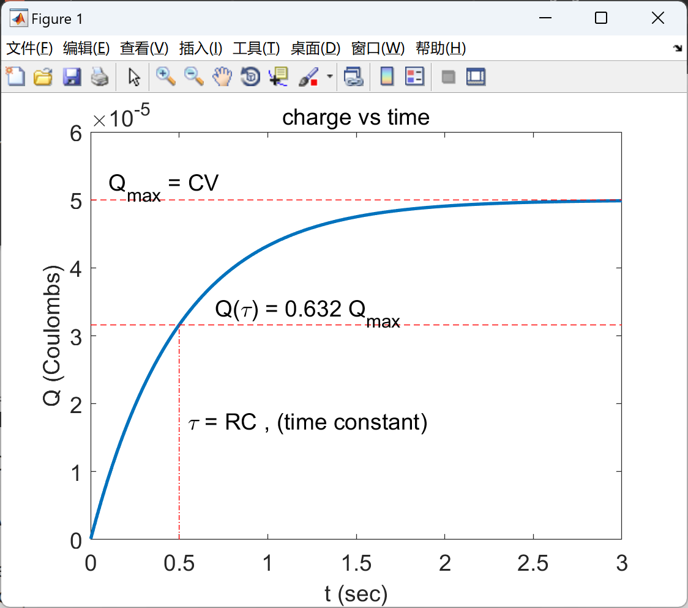
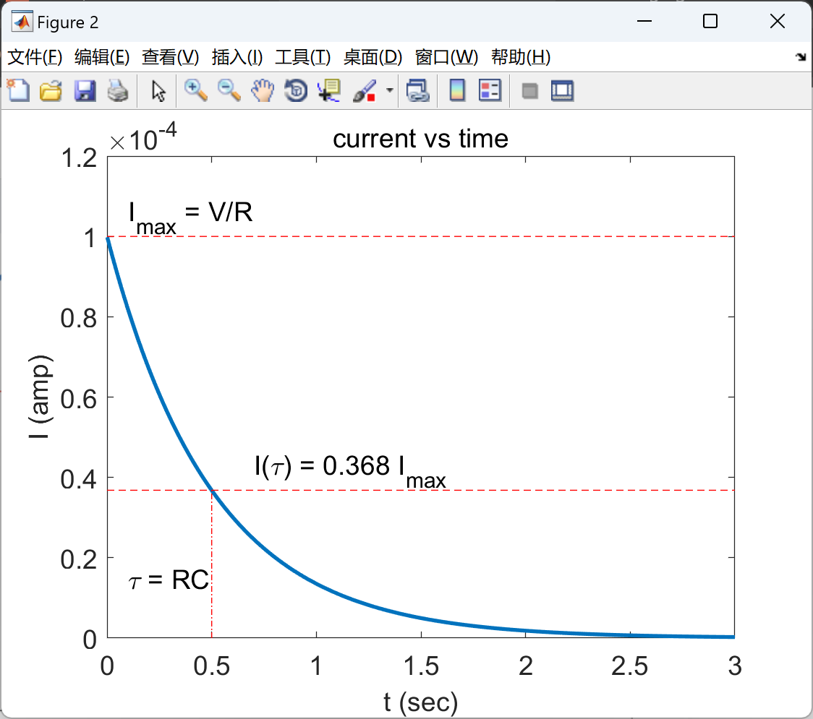

# [RC Circuit] Drawing the Image of I and Q Variation with Time in a Charging RC Circuit (Matlab Code Implementation)

The current and charge in the charging RC circuit were calculated and plotted over time. The equations for current and charge in this code were derived by applying Kirchhoff's loop law to a simple RC circuit with a battery.

## Images

<!-- PAYMENT_BLOCK -->

## Get this dataset

- Payment link (Stripe): [Buy now](https://buy.stripe.com/3cs8yP7sY87d0vu9AB)
- Payment QR code: 

<!-- /PAYMENT_BLOCK -->
